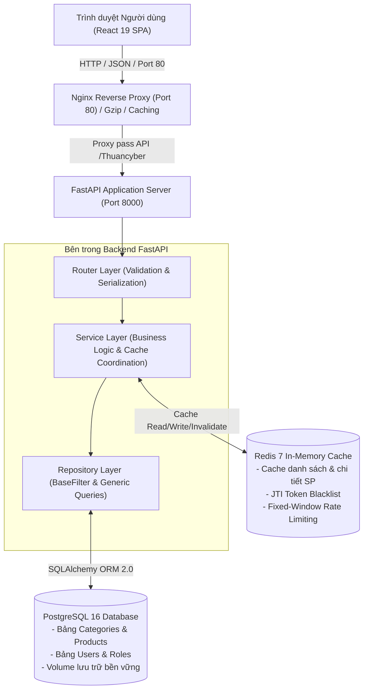
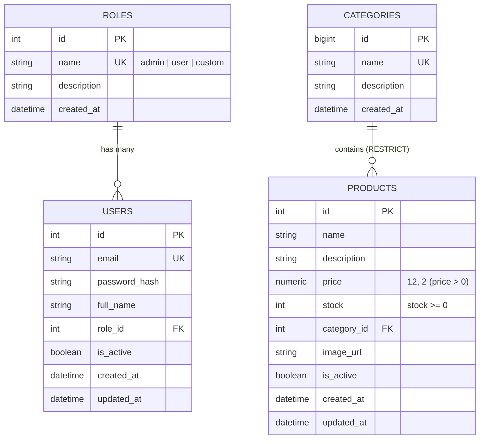

# Product Catalog Management System

Hệ thống ứng dụng web quản lý danh mục và sản phẩm thương mại toàn diện, được xây dựng trên nền tảng **FastAPI (Python 3.12)**, **React 19 (Vite)**, **PostgreSQL 16**, **Redis 7** và đóng gói hoàn chỉnh bằng **Docker Compose**.

Dự án áp dụng đầy đủ các chuẩn mực công nghiệp: Kiến trúc phân tầng 3 lớp (3-Tier Layered Architecture), chuẩn RESTful API, phân trang linh hoạt, chiến lược Cache-Aside hiệu năng cao, cơ chế phòng thủ sập nguồn (Graceful Degradation), xác thực bảo mật JWT kết hợp Refresh Token Rotation và Blacklist trên Redis, phân quyền vai trò RBAC và Rate Limiting chống tấn công brute-force.

---

## 📑 Mục lục tài liệu

- 📖 **[Tài liệu Kỹ thuật Backend](backend/README.md):** Kiến trúc phân tầng, SQLAlchemy ORM 2.0, DTO Schemas, Cache-Aside, Rate Limiter, Alembic và bộ 63 kiểm thử Pytest.
- 🎨 **[Tài liệu Kỹ thuật Frontend](frontend/README.md):** Kiến trúc React 19 Feature-Based, Dual-flow (Storefront & Admin), Axios Interceptor, Live API Logger và Multi-stage Docker Nginx.

---

## 🛠️ Ngăn xếp Công nghệ (Tech Stack)

| Phân hệ | Công nghệ | Phiên bản / Đặc tính kỹ thuật |
|---|---|---|
| **Backend Framework** | FastAPI | Python 3.12+, ASGI hiệu năng cao, Dependency Injection |
| **ORM & Database** | SQLAlchemy 2.0, PostgreSQL 16 | Declarative Mapped Models, Connection Pool `pool_pre_ping=True` |
| **Data Validation** | Pydantic v2, pydantic-settings | Parsing và xác thực kiểu dữ liệu siêu tốc bằng lõi Rust |
| **Caching & Invalidation** | Redis 7 (Alpine) | Cache-Aside pattern, MD5 composite key, SCAN pipeline deletion |
| **Database Migration** | Alembic | Quản lý phiên bản Schema tự động, cơ chế idempotent auto-bootstrap |
| **Security & Auth** | PyJWT, Passlib (BCrypt) | Băm mật khẩu BCrypt, Refresh Token Rotation, JTI Token Blacklist |
| **Frontend Framework** | React 19, Vite | Single Page Application (SPA), Functional Components, React Hooks |
| **UI & Icons** | Vanilla CSS Dark Theme, Font Awesome 6.5.2 | Giao diện hiện đại, tối ưu responsive, Live API Logger thời gian thực |
| **HTTP Communication** | Axios 1.20 | Request/Response Interceptor, auto-inject Bearer Token |
| **Containerization** | Docker, Docker Compose | Multi-stage build Nginx Alpine, Healthcheck tuần tự 4 services |
| **Automated Testing** | Pytest, FastAPI TestClient | 63 ca kiểm thử tự động bao phủ auth, cache, filter, pagination |

---

## 🏛️ Sơ đồ Kiến trúc Hệ thống (System Architecture)



---

## 🗄️ Sơ đồ Thực thể Quan hệ (ERD - Entity Relationship Diagram)



---

## 🚀 Hướng dẫn Khởi chạy Nhanh

### Cách 1: Khởi chạy bằng Docker Compose (Khuyên dùng - 1 lệnh duy nhất)

Toàn bộ hệ thống gồm 4 container (`postgres`, `redis`, `backend`, `frontend`) sẽ tự động cấu hình mạng, chờ database sẵn sàng qua cơ chế `healthcheck` và nạp sẵn 120 sản phẩm mẫu:

```bash
# Clone dự án và di chuyển vào thư mục gốc
git clone https://github.com/KhanhThuan-Cyber/product-catalog.git
cd product-catalog

# Khởi chạy toàn bộ hệ thống
docker compose up --build
```

- **Giao diện Web (Frontend):** [http://localhost](http://localhost) hoặc [http://localhost:5173](http://localhost:5173)
- **Tài liệu API tương tác (Swagger UI):** [http://localhost:8000/docs](http://localhost:8000/docs)
- **Cơ sở dữ liệu PostgreSQL:** Cổng `5432` (User: `postgres`, Password: `postgres`, DB: `Product-Catalog`)
- **Bộ nhớ đệm Redis:** Cổng `6379`

Để tắt hệ thống:
```bash
docker compose down
```

---

### Cách 2: Khởi chạy thủ công môi trường Phát triển (Local Dev)

#### 1. Khởi chạy Backend:
```powershell
cd backend

# Kích hoạt môi trường ảo Python
.\.venv\Scripts\Activate.ps1

# Cài đặt thư viện
pip install -r requirements.txt

# Thiết lập PYTHONPATH và chạy server
$env:PYTHONPATH = "src"
python -m uvicorn app.main:app --host 0.0.0.0 --port 8000 --reload
```

#### 2. Khởi chạy Frontend:
```bash
cd frontend
npm install
npm run dev
```

---

## 🔑 Tài khoản Mặc định & Dữ liệu Mẫu (Seed Data)

Khi hệ thống khởi động lần đầu, cơ chế `init_database` và `seed_products` sẽ tự động khởi tạo:

| Tài khoản | Email đăng nhập | Mật khẩu | Quyền hạn (Role) | Mô tả |
|---|---|---|---|---|
| **Super Admin** | `admin@system.local` | `Admin@123456` | `admin` | Toàn quyền thêm, sửa, xóa sản phẩm, danh mục, đổi role và xem live logs. |
| **Khách hàng mẫu** | Đăng ký trực tiếp tại nút "Đăng ký" trên web | Tự đặt | `user` | Xem danh sách, tìm kiếm, lọc giá, xem chi tiết và thêm vào giỏ hàng. |

* **Dữ liệu mẫu:** Hệ thống tự động nạp sẵn **120 sản phẩm** thuộc **5 danh mục chính** (Điện thoại, Laptop, Phụ kiện, Thiết bị mạng, Thiết bị văn phòng) phục vụ kiểm thử phân trang và bộ lọc ngay khi vừa khởi động.

---

## 📡 Danh mục RESTful API Endpoints (Prefix: `/Thuancyber`)

### 1. Quản lý Sản phẩm (`/Thuancyber/products`)

| Method | Endpoint | Quyền | Mô tả |
|---|---|---|---|
| `GET` | `/Thuancyber/products` | Công khai | Lấy danh sách sản phẩm phân trang, tìm kiếm, lọc giá, lọc danh mục và sắp xếp (có Redis Cache 60s). |
| `GET` | `/Thuancyber/products/{id}` | Công khai | Xem chi tiết sản phẩm theo ID (Redis Cache 60s). |
| `POST` | `/Thuancyber/products` | `Admin` | Thêm mới sản phẩm (Tự động xóa cache danh sách). |
| `PUT` | `/Thuancyber/products/{id}` | `Admin` | Cập nhật toàn bộ thông tin sản phẩm (Invalidate cache liên đới). |
| `PATCH` | `/Thuancyber/products/{id}` | `Admin` | Cập nhật nhanh một phần (ví dụ: chỉ sửa giá hoặc tồn kho). |
| `DELETE` | `/Thuancyber/products/{id}` | `Admin` | Xóa sản phẩm khỏi hệ thống (Xóa cache chi tiết và danh sách). |

**Các tham số Query của `GET /Thuancyber/products`:**
- `page`: Số trang (mặc định: `1`, tối thiểu: `1`).
- `page_size`: Kích thước trang (mặc định: `10`, tối đa: `100`).
- `search`: Từ khóa tìm kiếm theo tên sản phẩm (`ILIKE %search%`).
- `category_id`: Lọc theo mã danh mục.
- `min_price` / `max_price`: Khoảng giá (validate `min_price <= max_price`).
- `sort_by`: Cột sắp xếp an toàn (`id`, `price`, `created_at`, `name`).
- `order`: Hướng sắp xếp (`asc` hoặc `desc`).

---

### 2. Quản lý Danh mục (`/Thuancyber/categories`)

| Method | Endpoint | Quyền | Mô tả |
|---|---|---|---|
| `GET` | `/Thuancyber/categories` | Công khai | Lấy toàn bộ danh mục sản phẩm. |
| `GET` | `/Thuancyber/categories/{id}` | Công khai | Xem thông tin chi tiết một danh mục. |
| `POST` | `/Thuancyber/categories` | `Admin` | Tạo danh mục mới (Kiểm tra không trùng tên). |
| `PUT` | `/Thuancyber/categories/{id}` | `Admin` | Đổi tên hoặc mô tả danh mục. |
| `DELETE` | `/Thuancyber/categories/{id}` | `Admin` | Xóa danh mục (Chặn xóa nếu danh mục đang chứa sản phẩm). |

---

### 3. Xác thực & Quản lý Phân quyền

- `POST /Thuancyber/auth/register`: Đăng ký tài khoản người dùng mới (có giới hạn Rate Limit).
- `POST /Thuancyber/auth/login`: Đăng nhập, nhận Access Token (30 phút) và Refresh Token (7 ngày).
- `POST /Thuancyber/auth/logout`: Đăng xuất an toàn, thu hồi token đưa vào Redis JTI Blacklist.
- `GET /Thuancyber/auth/me`: Lấy thông tin tài khoản đang đăng nhập.
- `PATCH /Thuancyber/auth/me`: Cập nhật họ tên hiển thị cá nhân.
- `POST /Thuancyber/auth/change-password`: Đổi mật khẩu cá nhân.
- `GET /Thuancyber/users`: Danh sách người dùng (Chỉ dành cho Admin).
- `PATCH /Thuancyber/users/{id}/role`: Phân lại quyền/vai trò người dùng.

---

## ⚡ Các Cơ Chế Kỹ Thuật Nổi Bật

1. **Chiến lược Cache-Aside & Invalidation:**
   - Đọc dữ liệu: Kiểm tra Redis trước. Nếu có (Hit) trả về ngay $\le 2\text{ms}$; nếu không (Miss) query PostgreSQL và lưu Redis kèm TTL.
   - Khi có thay đổi (Create / Update / Delete): Thực hiện xóa key chi tiết `product:detail:{id}` và xóa an toàn hàng loạt key danh sách `product:list:*` thông qua lệnh `SCAN` kết hợp `pipeline.delete` (chống block server so với lệnh `KEYS *`).
2. **Cơ chế phòng ngừa lỗi Cache (Graceful Degradation):**
   - Lớp `NoOpRedisClient` tự động kích hoạt khi Redis không khả dụng. Ứng dụng tự động chuyển hướng mọi truy vấn xuống PostgreSQL, đảm bảo website không bị crash gián đoạn dịch vụ.
3. **Bảo mật Đa lớp & Giám sát thời gian thực:**
   - Access Token có `jti` duy nhất hỗ trợ Blacklist khi người dùng bấm Đăng xuất.
   - Cơ chế xoay vòng Refresh Token (RTR) phát hiện token bị đánh cắp.
   - Fixed-window Rate Limiter giới hạn số lần đăng nhập theo IP để phòng chống tấn công brute-force.
   - Giao diện Admin tích hợp công cụ **Live API Logger** hiển thị trực tiếp các request/response HTTP.

---

## 📁 Cấu trúc Thư mục Chuẩn của Dự án

```text
Product-Catalog/
├── README.md                           # Tài liệu tổng quan toàn bộ hệ thống (File này)
├── docker-compose.yml                  # Điều phối 4 container (Postgres, Redis, Backend, Frontend)
├── .env.example                        # Mẫu biến môi trường chung
├── .dockerignore                       # Loại trừ các file rác khi build docker
├── .gitignore                          # Loại trừ file tạm khỏi Git
├── backend/                            # Phân hệ Backend (FastAPI + Python 3.12)
│   ├── README.md                       # Hướng dẫn kỹ thuật chuyên sâu Backend
│   ├── Dockerfile                      # Đóng gói image Backend (python:3.12-slim)
│   ├── requirements.txt                # Thư viện phụ thuộc
│   ├── alembic/                        # Migration scripts quản lý cơ sở dữ liệu
│   ├── tests/                          # 63 unit/integration tests (pytest)
│   ├── run-tests.ps1                   # Script chạy test tự động
│   ├── seed.py                         # Script nạp 120 sản phẩm mẫu độc lập
│   └── src/app/                        # Mã nguồn ứng dụng (Clean 3-Tier Layered Architecture)
│       ├── main.py                     # Entry point FastAPI, CORS, routers
│       ├── core/                       # config, database, redis, rate_limiter, security, seed
│       ├── models/                     # SQLAlchemy Models (Product, Category, User, Role)
│       ├── schemas/                    # Pydantic Schemas (DTOs, Filter, Pagination)
│       ├── repositories/               # Repository queries (BaseRepository, BaseFilter)
│       ├── services/                   # Business Logic & Cache coordination
│       └── routers/                    # Endpoints (/Thuancyber/products, categories, auth, users)
└── frontend/                           # Phân hệ Frontend (React 19 + Vite)
    ├── README.md                       # Hướng dẫn kỹ thuật chuyên sâu Frontend
    ├── Dockerfile                      # Multi-stage build (Node 20 -> Nginx Alpine)
    ├── nginx.conf                      # Cấu hình Nginx reverse proxy, gzip, SPA fallback
    ├── package.json                    # Khai báo dependencies
    ├── vite.config.js                  # Cấu hình Vite & reverse proxy
    └── src/                            # Mã nguồn React 19 Feature-Based
        ├── api/                        # client.js (Axios + Logger pub/sub), endpoints.js
        ├── features/                   # auth, products, categories, users, profile
        ├── layouts/                    # MainLayout, AdminLayout, AuthLayout
        ├── guards/                     # AuthGuard, RoleGuard
        ├── hooks/                      # useDebounce, useProducts
        └── components/                 # common/ (Button, Input, Modal, ConfirmDialog)
```
